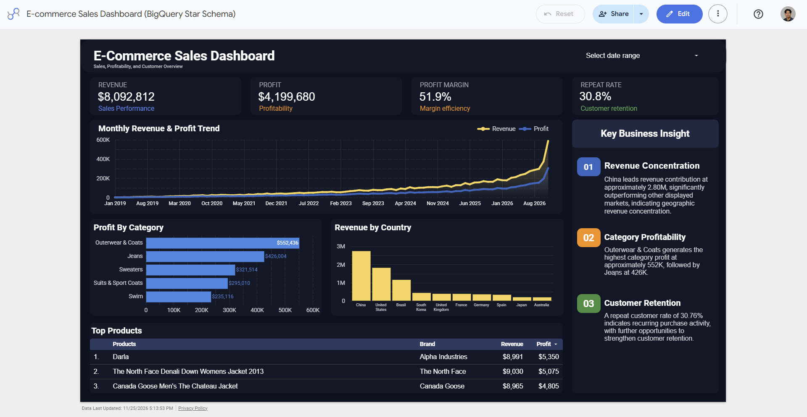
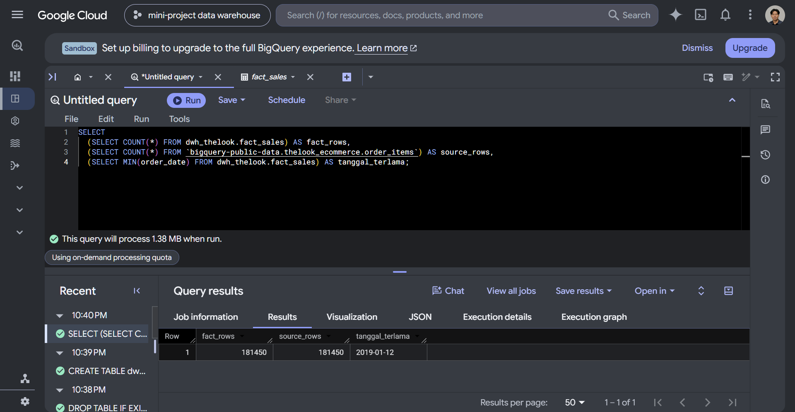

# E-commerce Data Warehouse (BigQuery Star Schema)

Mini project: memodelkan data e-commerce sintetis (thelook_ecommerce)
menjadi star schema di BigQuery, lalu menyajikannya di Looker Studio.

**Dashboard:** [https://datastudio.google.com/reporting/935f4596-8846-40a4-9e67-d164f3cf2dd5]

**Tools:** BigQuery (SQL), Looker Studio

## Model data
- fact_sales: 181.450 baris (order item), ukuran: sale_price, cost, gross_profit
- dim_customer, dim_product, dim_date
- 5 view analitik untuk dashboard (revenue bulanan, kategori, negara, repeat rate, top produk)

## Validasi data
- Jumlah baris fact_sales = sumber (181.450)
- Tidak ada baris yatim (orphan = 0)
- Temuan: partisi per tanggal di BigQuery Sandbox menghapus data lebih dari 60 hari
  (22.880 dari 181.450 baris tersisa). Diperbaiki dengan clustering, tanpa partisi.
  Di akun berbayar, partisi per tanggal akan dipakai.

## Insight
- Repeat customer rate 30,8%
- Outerwear & Coats memberi profit tertinggi; margin tiap kategori berbeda
- Revenue terkonsentrasi di beberapa negara

## Catatan
Data sintetis, bukan data warehouse produksi.

## File
- dwh_thelook.sql
- screenshots/ (quality check sebelum dan sesudah, dashboard)
